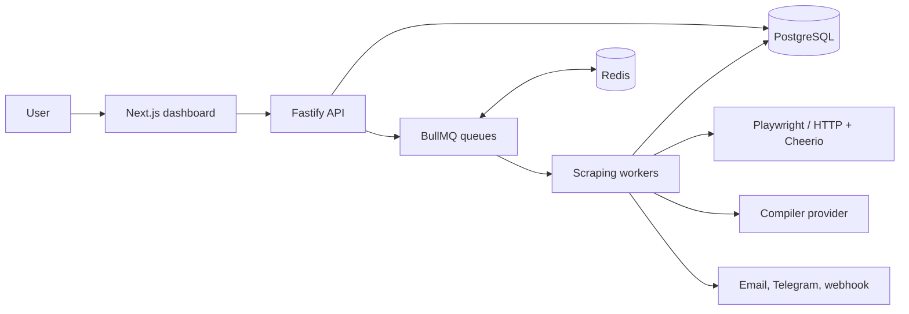

# Specter

<p align="center">
  
</p>

<p align="center"><strong>Monitor changes on the web, without writing a scraper for every site.</strong></p>

Specter turns a URL and a plain-language description into a monitored data feed. It uses AI to configure and validate an extraction plan, then runs that plan on a schedule. Routine checks are deterministic and do not call an AI model; when a page changes, Specter can review and recover the plan.

## Why Specter

Website layouts change, and one-off scrapers tend to break silently. Specter is designed to monitor user-selected pages over time, validate each result before updating its baseline, and report meaningful changes. It is for focused monitoring of URLs you choose, rather than broad web crawling.

## How it works

1. Describe what you want to monitor and provide a page URL.
2. Specter inspects the page and uses a configured model to create and validate an extraction plan.
3. A scheduled worker fetches the page using HTTP or a browser and executes the plan without an AI call on routine runs.
4. Valid results are compared with the previous baseline and changes are sent through configured notification channels.
5. If a site change makes extraction fail, bounded recovery can revise the plan.

## Architecture



The repository is a TypeScript monorepo:

- `frontend/` — Next.js App Router dashboard.
- `backend/` — Fastify API, BullMQ workers, Drizzle ORM, extraction pipeline, and provider adapters.
- `packages/contracts/` — shared API and domain contracts.
- PostgreSQL stores users, monitors, plans, runs, and snapshots; Redis backs queues and coordination.

## Run locally with Docker

### Requirements

- Docker Engine with the Compose plugin
- A Gemini API key for configuring monitors (the default compiler provider)

### 1. Configure the environment

```bash
cp .env.example .env
```

Edit `.env` and set the required local values:

| Variable | Required for | How to set it |
| --- | --- | --- |
| `ENCRYPTION_KEY` | Backend startup | Generate with `openssl rand -hex 32` |
| `COMPILER_API_KEY` | AI-assisted monitor setup | Your Gemini API key |
| `COMPILER_API_MODEL` | AI-assisted monitor setup | Gemini model name, for example `gemini-2.5-flash` |

Generate the encryption key with:

```bash
openssl rand -hex 32
```

Paste the output into `ENCRYPTION_KEY` in `.env`.

The example file uses local-only database credentials, console notifications, and development JWT settings. Do not reuse those defaults in a public deployment. Email delivery, Google sign-in, proxy/unblocker services, and screenshot storage are optional integrations; configure them only if you need them.

### 2. Start the app

```bash
docker compose -f docker-compose.dev.yml up --build
```

Open the dashboard at [http://localhost:3005](http://localhost:3005). The API is available at [http://localhost:3001](http://localhost:3001). The first build installs the Playwright browser and can take a few minutes.

Stop the containers with `Ctrl+C`, or run `docker compose -f docker-compose.dev.yml down`. Add `-v` only if you also want to delete the local PostgreSQL and Redis data.

## Self-hosting

The Compose files have different purposes:

- `docker-compose.dev.yml` builds and runs the full development stack with source mounts and hot reload.
- `docker-compose.yml` is the full container build stack; use it for a local production-style build after configuring `.env`.
- `docker-compose.prod.yml` is for the backend deployment workflow. It expects `.env.prod` for runtime configuration and `DOCKER_IMAGE` for the published backend image; set both in the deployment environment, not the local `.env.example`.

For production, configure unique secrets, a stable `ENCRYPTION_KEY`, the public frontend/API URLs, and a supported compiler provider. Keep `.env` and `.env.prod` private. See [`.env.example`](.env.example) for available settings and [the extraction engine guide](docs/extraction-engine.md) for detailed behavior.

## Development

```bash
npm run typecheck
npm test
npm run lint
```
## License

Specter is source available under the [Specter Source Available License](LICENSE), not an OSI-approved open-source license. The license permits personal, educational, and internal business use, with restrictions on commercial redistribution and offering the software as a service. The hosted Specter service is operated by the project owner.
