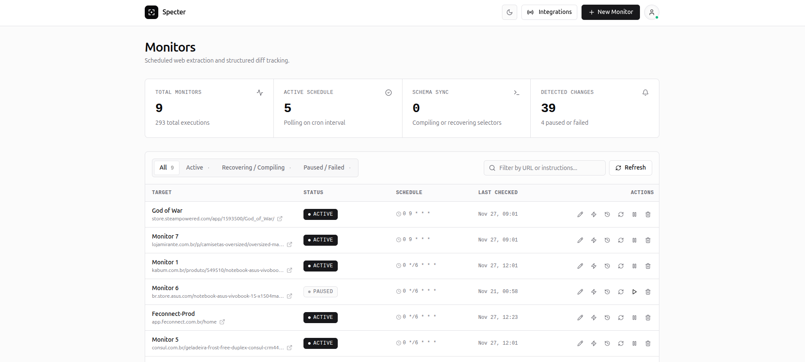
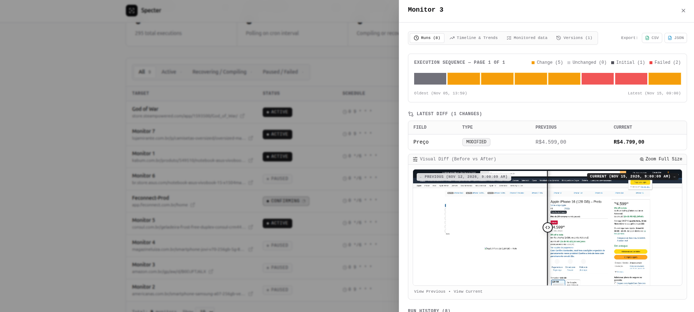
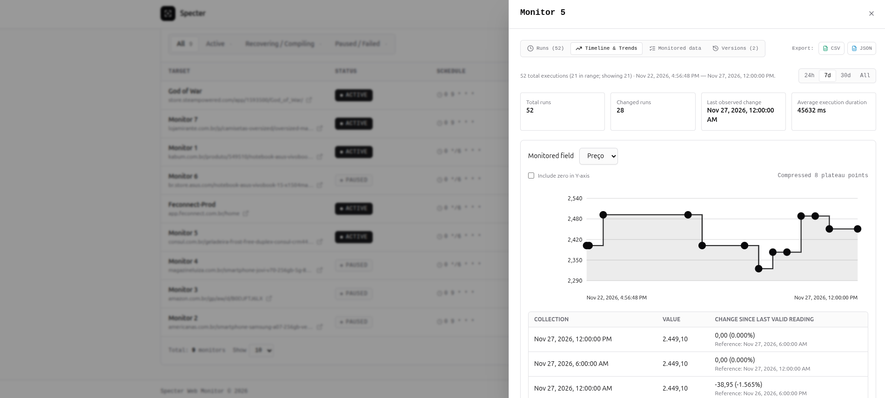
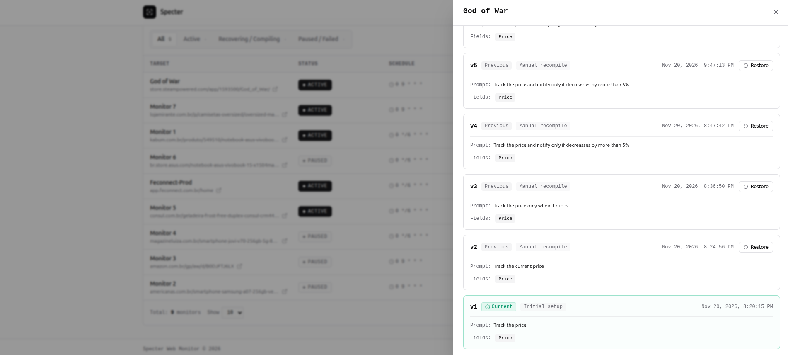
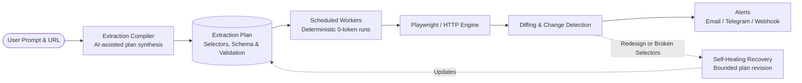

# Specter

<p align="center">
  
</p>

<p align="center">
  <strong>Autonomous web change monitor with AI-assisted setup and deterministic execution.</strong>
</p>

<p align="center">
  <a href="#how-it-works">How It Works</a> •
  <a href="#screenshots">Screenshots</a> •
  <a href="#quick-start-with-docker">Quick Start</a> •
  <a href="#self-hosting">Self-Hosting</a> •
  <a href="#license">License</a>
</p>

---

## What is Specter?

Specter turns any web page into a monitored, structured data feed from a simple URL and a plain-language prompt (e.g., *"track the product price and stock availability"*).

- **Code-Gen Once, Deterministic Execution**: AI is only invoked during setup or recovery. Routine scheduled checks run directly via Playwright or HTTP with **zero LLM token overhead**.
- **Visual & Structured Diffs**: Detect meaningful data modifications and review changes with side-by-side screenshot comparisons.
- **Self-Healing Pipelines**: If a website redesign breaks CSS selectors, bounded auto-recovery analyzes the updated DOM and repairs the extraction plan automatically.
- **Smart Notifications**: Instant alerts via Webhooks, Email, or Telegram when tracked data changes.

---

<a name="screenshots"></a>
## Screenshots

### 1. Centralized Monitor Dashboard
Track all monitored targets, execution cadences, schema sync states, and historical change counts in one view.


### 2. Visual & Structured Diffs
Compare modifications instantly with interactive before/after visual sliders and exact field-level deltas.


### 3. Historical Trends & Analytics
Inspect numerical values over time with automatic plateau compression and historical variation trends.


### 4. Transparent Versioning & Rollback
Full version control for every extraction plan. Review prompt iterations, audit automated healing decisions, and rollback schemas with one click.


---

<a name="how-it-works"></a>
## How It Works



1. **Synthesize Plan**: You provide a target URL and what you want to extract. Specter fetches the live DOM and uses a model (Gemini or Codex) to compile robust CSS selectors, parsing rules, and schema assertions.
2. **Deterministic Polling**: Scheduled background workers periodically execute the compiled plan using headless Chromium or lightweight HTTP. No AI models are called during normal execution, keeping operational costs near zero.
3. **Diff & Alert**: Extracted records are normalized and hashed. When values deviate from the baseline, Specter captures visual snapshots and triggers notification channels.
4. **Self-Healing Loop**: If layout changes break extraction, Specter's bounded recovery detects the structural failure and re-synthesizes the extraction plan automatically.

---

<a name="quick-start-with-docker"></a>
## Quick Start with Docker

### Prerequisites
- [Docker](https://docs.docker.com/get-docker/) & Docker Compose
- A [Google Gemini API Key](https://aistudio.google.com/) (free tier available; used only when creating or recovering monitors)

### 1. Initialize Environment

Run the automated setup script to generate configuration and encryption keys:

```bash
./scripts/setup.sh
```

*(Alternatively, copy `.env.example` to `.env` manually and set `ENCRYPTION_KEY` using `openssl rand -hex 32`)*.

Add your Gemini API key to `.env`:
```env
COMPILER_API_KEY=your_gemini_api_key_here
```

### 2. Start Specter

```bash
docker compose -f docker-compose.dev.yml up
```

Open your browser:
- **Dashboard**: [http://localhost:3005](http://localhost:3005)
- **Backend API**: [http://localhost:3001](http://localhost:3001)

To stop the containers:
```bash
docker compose -f docker-compose.dev.yml down
```

---

<a name="self-hosting"></a>
## Self-Hosting

Specter is designed to run efficiently on low-cost infrastructure. Because routine scraping runs deterministically without continuous LLM streaming, a modest **1 vCPU / 2 GB RAM VPS** (e.g., Hetzner, DigitalOcean) easily handles dozens of active monitors.

### Production Deployment

1. **Environment Configuration**:
   - Copy `.env.example` to your production environment file (e.g. `.env.prod`).
   - Generate a cryptographically secure `ENCRYPTION_KEY` (`openssl rand -hex 32`).
   - Set a strong, unique `JWT_SECRET` (at least 32 characters).
   - Set `CORS_ORIGIN` and `FRONTEND_URL` to match your public domain.
   - Configure your notification provider (Console or Resend).

2. **Run Production Containers**:
   ```bash
   docker compose up -d --build
   ```
   Database migrations run automatically on container boot.

3. **Reverse Proxy (Nginx / Caddy / Cloudflare)**:
   Route incoming traffic to:
   - Frontend UI: `http://127.0.0.1:3005` (or static export via Nginx)
   - Backend API: `http://127.0.0.1:3001` (with WebSocket / SSE support enabled for real-time progress)

For detailed extraction engine configuration, anti-bot cascades, and proxy rotation, see the [Extraction Engine Guide](docs/extraction-engine.md).

---

<a name="license"></a>
## License

Specter is available under the [Specter Source Available License](LICENSE). 

- **Permitted**: Personal use, educational projects, and internal business monitoring.
- **Restricted**: Commercial redistribution, white-labeling, or offering Specter as a commercial hosted service (SaaS) to third parties.

The hosted version of Specter is operated by the project owner.
